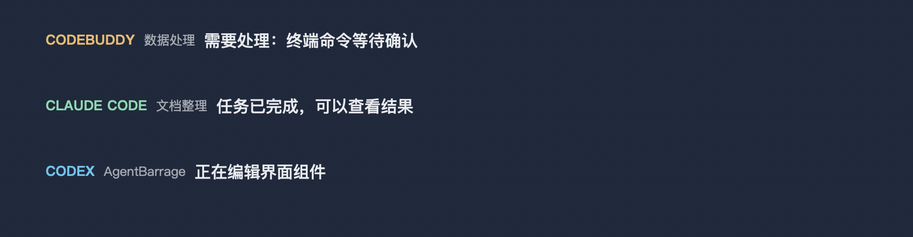

# AgentMarquee


[](https://github.com/MEDADA/AgentMarquee/actions/workflows/test.yml)
[](LICENSE)

把 Codex 等 AI 工具的工作事件显示为 **macOS 桌面弹幕**。当多个任务同时运行时，你可以在当前窗口上看到进度、完成、需处理和失败提示。程序常驻菜单栏，弹幕点击穿透，不占用程序坞。



> **项目状态：早期版本。** 目前公开源码，尚未提供签名、公证的 `.app` 下载。macOS 显示层已可运行；Codex Hook 已在本机实际触发，Claude Code 与 CodeBuddy Code 适配器已用模拟输入验证，真实版本与产品形态仍在验收。详见[兼容性与限制](#兼容性与限制)。

此前项目名为 AgentBarrage。旧仓库地址会跳转到新地址；旧命令和旧 Hook 入口暂时保留。首次运行时，程序会将旧用户目录中的设置、来源和本机接口密钥复制到 `~/Library/Application Support/AgentMarquee/`，不会覆盖新目录中的文件。若移动已有源码目录，请先卸载 Hook，再在新目录重新安装。

## 功能

- **多来源事件：** Codex、Claude Code、CodeBuddy Code 使用独立 Hook 适配器；其他工具可通过命令或可选的本机 HTTP 接口发送。
- **原生弹幕：** 滚动或固定停留、区域和密度控制、重要事件优先显示，并可暂停或过滤。
- **外观设置：** 胶囊、轻盈和纯文字样式；字体、字号、文字颜色、外描边、透明度与间距均可调整。纯文字样式不显示状态灯、背景或来源图标。
- **隐私与历史：** 默认显示短状态；可选择展示经过筛选的部分详情。最近 200 条已显示事件只保存在内存中。

## 快速开始

需要 **macOS、Python 3.11+ 和 Git**。在终端运行：

```sh
git clone https://github.com/MEDADA/AgentMarquee.git
cd AgentMarquee
python3 -m venv .venv
./.venv/bin/python -m pip install '.[macos]'
./.venv/bin/agent-marquee
```

启动后，菜单栏会出现 AgentMarquee 图标。首次运行只等待真实事件，不会自动播放假数据。想先看动效，可将最后一条命令改为 `./.venv/bin/agent-marquee --demo`。

保持程序运行，在另一个终端发送测试弹幕：

```sh
./.venv/bin/agent-marquee-send --agent my-agent --kind success --message "测试完成" --project Demo
```

`kind` 可选 `working`、`success`、`attention`、`error`。控制窗的“弹幕设置”可调整字体和颜色；关闭控制窗后，可从菜单栏重新打开。选择菜单栏中的“退出 AgentMarquee”才会结束程序。

## 接入 AI 工具

### Codex、Claude Code、CodeBuddy Code

打开 **智能体接入**，选择对应工具的“安装 / 更新”。程序会分别修改该工具的用户级 Hook 配置，并保留其他配置；首次修改已有配置时会生成备份。Codex 和 CodeBuddy Code 还需要在各自的 `/hooks` 中完成信任审查。正在运行的会话可能需要重启。

安装前想查看将修改的配置和事件，可用命令行预览：

```sh
./.venv/bin/agent-marquee-hooks --agent codex --dry-run
```

### 其他 AI 工具或对话

在 **智能体接入 → 添加或管理其他来源** 登记名称与标识，复制程序生成的发送命令，再放入该工具的 Hook、脚本或自动化动作。也可直接调用 `agent-marquee-send`。添加来源本身不会读取该工具的对话；自动发送需要来源工具提供事件接口。

接入方式、可选的本机 HTTP 接口、链接跳转和事件字段见[任意来源接入指南](INTEGRATIONS.md)。

## 没有看到弹幕？

1. 确认 AgentMarquee 仍在运行，且没有在菜单栏中暂停弹幕。
2. 先发送[快速开始](#快速开始)中的测试事件，确认显示层和本机投递正常。
3. 若测试事件可见，检查对应工具的 Hook 是否安装、完成信任审查，并重启已有会话；同时检查“类型过滤”和“进度弹幕”设置。

## 兼容性与限制

| 来源 | 当前状态 |
| --- | --- |
| Codex Hook | 本机真实触发并显示；其他版本仍需持续验证 |
| Claude Code Hook | 适配器和安装器已实现，模拟 Hook 输入通过；真实环境待验收 |
| CodeBuddy Code Hook | 适配器和安装器已实现，模拟 Hook 输入通过；桌面版与 IDE 接口待确认 |
| 其他本机工具 | 支持显式发送命令；能否自动发送取决于工具的 Hook 或自动化能力 |
| 浏览器 AI 对话 | 尚无通用浏览器扩展；不能自动读取任意网页对话 |

显示层目前仅支持 macOS。屏幕共享、全屏、多显示器和无障碍体验仍需进一步实机验收；进度见[产品计划](PLAN.md)和[发布检查清单](RELEASE.md)。

## 隐私与卸载

内置适配器只发送预设短句和经过筛选的短详情，不发送原始提问、完整命令、工具输出或凭证。弹幕历史只在内存中，退出后消失；开启隐私模式会隐藏屏幕上的来源和内容，并清空旧历史。程序不读取屏幕、剪贴板或浏览器页面。本机 HTTP 接口默认关闭，开启后需要独立密钥。自定义来源的发送者应自行检查消息内容。

卸载 Hook 前，请先在“智能体接入”中逐个选择“卸载”，或运行：

```sh
./.venv/bin/agent-marquee-hooks --agent codex --uninstall
./.venv/bin/agent-marquee-hooks --agent claude-code --uninstall
./.venv/bin/agent-marquee-hooks --agent codebuddy --uninstall
```

之后退出程序并移除仓库即可。Hook 命令包含仓库的绝对路径，因此**移动或删除仓库前应先卸载 Hook**。设置和自定义来源默认保留在 `~/Library/Application Support/AgentMarquee/`，可按需手动删除。

## 开发与贡献

核心事件协议与各工具适配器不依赖 AppKit；macOS 显示层位于 `agent_marquee/display/macos.py`。运行测试：

```sh
python3 -m unittest discover -s tests -v
```

新增适配器、报告问题或提交代码前，请阅读[架构说明](ARCHITECTURE.md)、[贡献指南](CONTRIBUTING.md)和[安全问题反馈](SECURITY.md)。漏洞请通过仓库的私密报告渠道提交，不要放在公开 Issue。

本项目采用 [MIT 许可证](LICENSE)。
